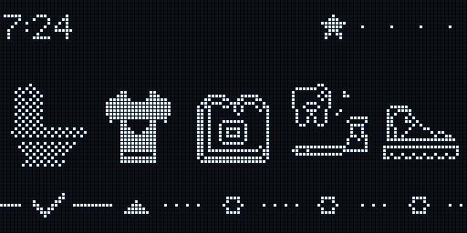
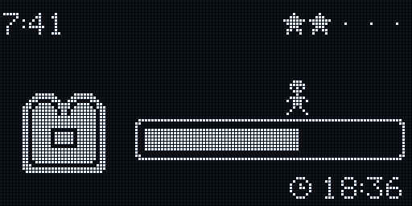
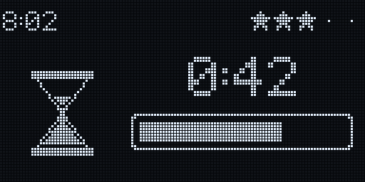
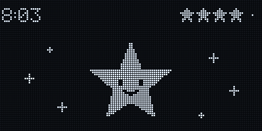
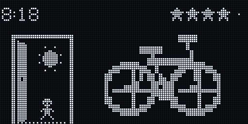
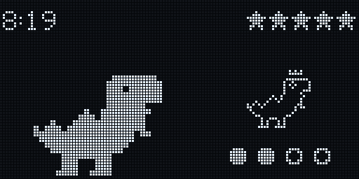
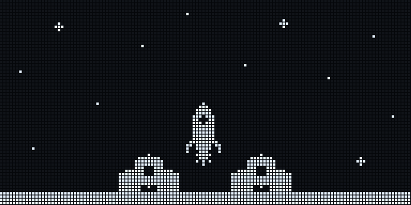
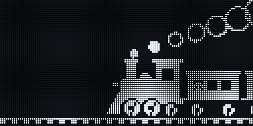

# ESP32 Morning Routine

A one-button morning routine timer for kids, on an ESP32-C3 and a 128×64 OLED.
It walks through each task (toilet, getting dressed, breakfast, teeth, shoes),
hurries you along when time runs low, hands out stars, and ends each morning
with a random surprise animation. A pet dino grows a little every morning.

| | | |
|:-:|:-:|:-:|
|  |  |  |
| Overview | Task timer | Hurry up (last minute) |
|  |  |  |
| Task done | Time to leave | Dino pet |
|  |  |  |
| Surprise: rocket | Surprise: train | Surprise: UFO (rare) |

## Hardware

- ESP32-C3 Super Mini
- 0.96" SSD1306 I²C OLED, 128×64 (for a 1.3" SH1106, set `OLED_SH1106 1` in the `.ino`)
- One push button (arcade button)
- Passive piezo buzzer and a 100 Ω resistor

| Part | ESP32-C3 pin |
|---|---|
| OLED SDA | GPIO 3 |
| OLED SCL | GPIO 4 |
| OLED VCC / GND | 3V3 / GND |
| Button | GPIO 20 → GND (internal pull-up) |
| Buzzer | GPIO 5 → 100 Ω → buzzer → GND |

## Getting started

### 1. Install arduino-cli

```sh
brew install arduino-cli          # macOS
# Linux / Windows: https://arduino.github.io/arduino-cli/latest/installation/

arduino-cli config init
arduino-cli config add board_manager.additional_urls \
  https://espressif.github.io/arduino-esp32/package_esp32_index.json
arduino-cli core update-index
```

The board, ESP32 core version (3.3.12) and U8g2 library version are pinned in
[sketch.yaml](sketch.yaml). `arduino-cli` downloads them automatically on the
first compile.

**USB driver:** none needed. The ESP32-C3 has native USB, so it shows up as a
serial port on its own:

- macOS: `/dev/cu.usbmodem*`
- Linux: `/dev/ttyACM0`. Add yourself to the `dialout` group (`sudo usermod -aG dialout $USER`, then log out and back in).
- Windows 10/11: `COMx`

### 2. Clone and add your WiFi

The folder name must match the `.ino` file name, so clone into `esp32-morning-routine`:

```sh
git clone https://github.com/francolucas/ESP32-Morning-Routine.git esp32-morning-routine
cd esp32-morning-routine
cp secrets.example.h secrets.h    # then put your WiFi name and password in secrets.h
```

WiFi is only used to fetch the time over NTP. `secrets.h` is git-ignored.

### 3. Build and upload

```sh
arduino-cli board list                        # find the port
arduino-cli compile
arduino-cli upload -p /dev/cu.usbmodem1101    # use your port
arduino-cli monitor -p /dev/cu.usbmodem1101 -c baudrate=115200
```

**Press the RESET button after uploading.** After a USB reset this board often
stays in download mode ("waiting for download") instead of starting the firmware.

If the upload can't connect: hold **BOOT**, press **RESET**, let go of **BOOT**,
then upload again.

On macOS, if `compile` fails with `ctags: cannot open temporary file`, run it
as `TMPDIR=/tmp arduino-cli compile`.

## Using it

One button:

- **Press**: task done, leaving, or wake the screen
- **Hold 1 s**: peek at the overview during a task
- **Hold 5 s**: restart the routine (in the morning), or start a 20× speed test run (any other time)

The leave time (08:20), time zone and task durations are at the top of
[esp32-morning-routine.ino](esp32-morning-routine.ino) and in
[oled_gfx.h](oled_gfx.h) (`TASKS`).

From the serial monitor, send `s` to play a random surprise, or `s0` … `s12`
to play a specific one.

## Regenerating the screenshots

The drawing code has no Arduino dependencies, so it also builds on a desktop:

```sh
c++ -std=c++17 -O2 -I. tools/render_screens.cpp -lz -o tools/render_screens
tools/render_screens docs/images
```
